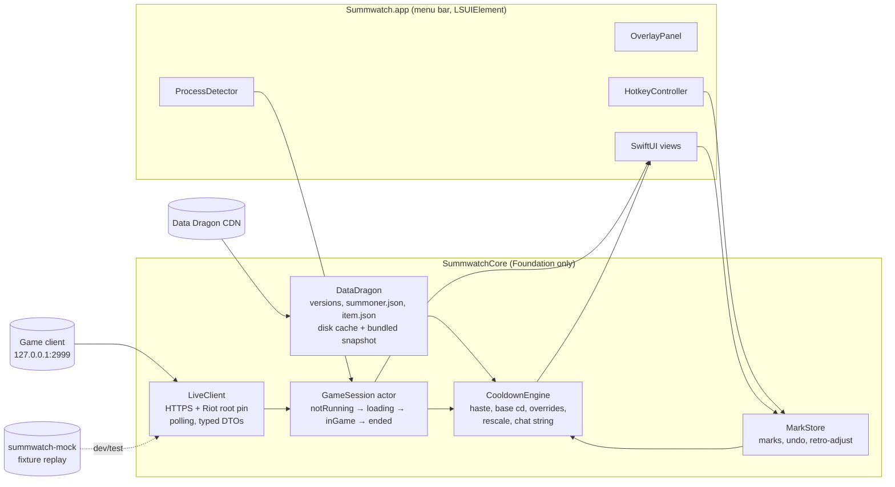

# Architecture

Summwatch has two parts: a **UI-agnostic core** that can be fully tested without a running game, and a thin **macOS app** that draws the overlay and handles input.

## Core (`Sources/SummwatchCore`)

| Component | Responsibility |
|---|---|
| **LiveClient** | Polls `https://127.0.0.1:2999/liveclientdata/*`. TLS trust is pinned to Riot's published root certificate. The transport is a protocol, so tests and the mock server can swap it out. |
| **DataDragon** | Resolves the current version from `versions.json` and fetches `summoner.json` (base cooldowns) and `item.json`. Caches per version under Application Support, and falls back to a bundled snapshot when offline. |
| **GameSession** | An actor running the state machine. It identifies the active player and the enemy team, and handles loading screens, reconnects, and new-game detection. |
| **CooldownEngine** | Pure functions. Cooldown is `base × 100 / (100 + haste)`. Haste comes from boots (detected from items), Cosmic Insight (manual toggle), and the ARAM aura. Patch quirks live in a versioned overrides file. |
| **MarkStore** | User marks keyed by player and spell slot, with retro-adjust and undo. |

### Key rules
- **Game time, not wall-clock time.** Countdowns use `gameData.gameTime`, interpolated between polls with a monotonic clock, so pauses are handled for free.
- **Spell identity** comes from `rawDisplayName` (for example `GeneratedTip_SummonerSpell_SummonerFlash_DisplayName`), never the localized `displayName`.
- **Resilience:**
  - No probing while the game process isn't running.
  - A refused connection or 404 means the game is still loading.
  - If the API disappears mid-game, keep the marks and resume when it returns.
  - If `gameTime` goes backwards or the player set changes, it's a new game, so reset.
- **Unknown data never crashes the app.** A new spell shows a generic icon with no countdown.
- **No AppKit or SwiftUI imports** in this module.

## App (`Sources/SummwatchApp`)

- A menu bar app (`LSUIElement`, accessory activation policy) with no Dock icon.
- **Overlay:** an `NSPanel` with `.nonactivatingPanel`, `level = .screenSaver`, and `collectionBehavior = [.canJoinAllSpaces, .fullScreenAuxiliary, .stationary, .ignoresCycle]`. This follows [Apple DTS's guidance](https://developer.apple.com/forums/thread/826308) for staying above full-screen Spaces.
- **Click-through by default** (`ignoresMouseEvents = true`). Clicks only reach the overlay while in interaction mode. The panel never becomes key, so League keeps focus.
- **Hotkeys:** Carbon hotkeys via [KeyboardShortcuts](https://github.com/sindresorhus/KeyboardShortcuts). They need no Accessibility permission, and users can rebind them. Defaults use ⌃⌥ chords to avoid League's keybinds.

## Mock server (`Sources/SummwatchMock`)

`summwatch-mock` serves recorded fixtures as a fake Live Client API over plain HTTP, so the app and tests run without the game.

- Fixtures are timelines: ordered `allgamedata` snapshots plus scripted phases (connection refused, 404, spectator error, game ended).
- `summwatch-mock record` captures a real game and **anonymizes Riot IDs** before the fixture can be committed.

## Decision records

Architectural decisions are recorded in [`docs/adr/`](adr/).
